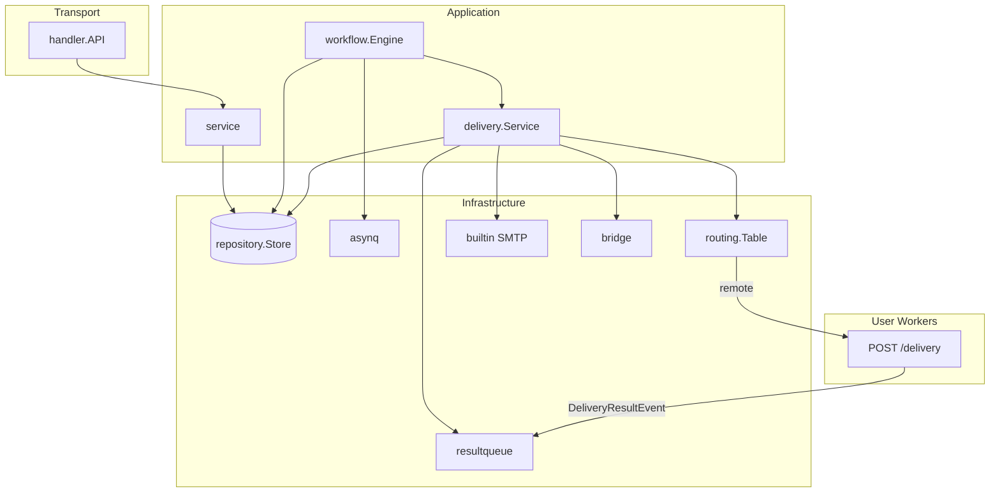
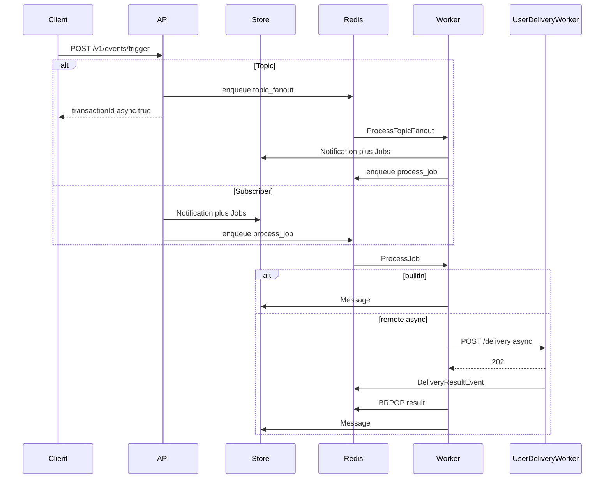

# Herald 架构

> Module：`github.com/SolaTyolo/herald`

## 1. 概述

**Herald** 是受 [Novu](https://github.com/novuhq/novu) 启发的通知基础设施。渠道投递采用 **Traefik v3 风格 YAML 声明式路由**：

- **builtin**：`smtp_email`、`inapp` — 在 Asynq Worker 进程内本地执行
- **remote**：用户自建 Delivery Worker（`POST /delivery`），由 YAML `services` + `providers` 映射

| 组件 | 技术 |
|------|------|
| API | Chi、REST、OpenTelemetry |
| Worker | Asynq + Redis（工作流任务、Topic fan-out） |
| 持久化 | `file`（JSON）或 `db`（GORM：PostgreSQL / MySQL / SQLite） |
| 渠道路由 | `PROVIDERS_CONFIG` YAML + fsnotify 热加载 |
| 结果回传 | Redis 结果队列（默认）或 HTTP 同步体 |
| 用户扩展 | 自建 HTTP Worker，契约见 `pkg/contract` |

## 2. 目录与分层

```
cmd/api                 HTTP（bootstrap.RoleAPI）
cmd/worker              异步任务（bootstrap.RoleWorker）
config/providers.yaml   Traefik 风格 services + providers
internal/
  domain/               纯实体
  repository/           Store 端口 + Open 工厂
  service/              用例层
  workflow/             步骤编排引擎
  delivery/             smtp / in_app / remote + resultqueue
  routing/              YAML 路由表 + 热加载 + 健康探测
  queue/asynq/          任务入队
  realtime/bridge/      Worker ↔ API（in_app webhook）
  telemetry/
  transport/http/
  bootstrap/
pkg/contract/           DeliveryRequest / DeliveryError / DeliveryResultEvent
```



**设计原则：**

- 业务层只依赖 `repository.Store` 与 `routing.Table` / delivery，不感知 GORM
- builtin 本地执行；remote 转发用户 Worker
- `QUEUE_MODE=asynq` 时 API 与 Worker 共用 `PROVIDERS_CONFIG`、`REDIS_ADDR`；`local` 单进程、不用 Redis
- `Integration.providerId` 必须等于 YAML `providerName`

## 3. 持久化

| `STORE_TYPE` | 行为 |
|--------------|------|
| `file` | `{STORE_FILE_PATH}/` 下 JSON |
| `db` | GORM + `DB_DRIVER`（postgres / mysql / sqlite） |

- 端口：`repository.Store`；缺失记录用 `repository.IsNotFound(err)`
- Migration：仅 **API** 启动时 AutoMigrate

## 4. Provider 与投递

详见 [PROVIDERS.md](PROVIDERS.md)。

```
delivery.SendChannel
  ├─ in_app  → CreateMessage + bridge.Publisher
  └─ 其他 channel → ListActiveIntegrations → routing.Lookup(providerId)
       ├─ builtin smtp_email → 本地 SMTP
       └─ remote → POST service.endpoint
            └─ async：Worker 202 + Redis 结果队列；sync：HTTP 响应体
```

### 动态模板

可复用模板，形态对齐 SendGrid Dynamic Templates：一个模板有多个 version，其中一份 `active`。渠道步骤设置 `templateId` 后，投递时渲染 **active version**；步骤上的内联 `template` 在有 `templateId` 时不使用。

占位符与内联模板相同，触发 `payload` 同时挂在根上，所以 `{{.orderId}}` 与 `{{.payload.orderId}}` 等价，订阅者用 `{{.subscriber.firstName}}`。邮件用 `htmlContent`（空则用 `plainContent`）；sms / push / chat 优先 `plainContent`。

`providerTemplateId` 会写入远端 `DeliveryRequest.message.template_id`，标量 payload 写入 `template_params`，供用户 Worker 转给 SendGrid 一类上游。

```
POST /v1/templates
POST /v1/templates/{id}/versions
POST /v1/templates/{id}/preview
```

### In-app

```
in_app 步骤 → Worker 写 messages → bridge.Publisher
         → API bridge.Subscriber →（可选）POST subscriber.webhookUrl
客户端：GET /v1/subscribers/{id}/messages
```

### 投递保障

| 能力 | 行为 |
|------|------|
| 重试 | 仅 `DeliveryError.retryable=true` 触发 Asynq 重试；否则 `SkipRetry` |
| 幂等 | 发前 `GetMessageByJobID`；已有 message 则跳过 |
| Failover | `Retryable` 不上探其他 Integration |
| 健康探测 | YAML `healthCheck` 周期探测；不健康则 remote 可重试失败 |
| Topic | 触发入队 `workflow:topic_fanout`，响应 `async: true` |

## 5. 核心数据流



## 6. 可观测性

| 变量 | 说明 | 默认 |
|------|------|------|
| `LOG_LEVEL` | debug / info / warn / error | `info` |
| `LOG_FORMAT` | text / json | `text` |
| `OTEL_ENABLED` | OTLP 导出 | `false` |
| `OTEL_EXPORTER_OTLP_ENDPOINT` | OTLP HTTP 端点 | `http://localhost:4318` |

Worker 对 `process_job` / `digest_flush` / `topic_fanout` 与 remote HTTP 打 span。

## 7. 安全

| 资产 | 机制 |
|------|------|
| API Key | bcrypt + `key_prefix` |
| Integration 凭据 | AES-GCM；`ENCRYPTION_KEY` 32 字节 |
| Message API | 更新绑定 `(env_id, subscriber_pk)` |

## 8. 部署

1. Migration 仅 API 执行
2. API 与 Worker 挂载同一 `PROVIDERS_CONFIG`
3. `QUEUE_MODE=asynq` 时共用 Redis（Asynq、bridge、结果队列、throttle）
4. 生产禁止默认 `ENCRYPTION_KEY`（除非 `DEV_MODE`）
5. 用户 Delivery Worker 独立部署，YAML 配置 endpoint；async 模式需能写同一 Redis

```bash
make docker-up
DEV_MODE=true make build
DEV_MODE=true make run-api    # terminal 1
make run-worker               # terminal 2
```

## 9. 环境变量

| 变量 | 默认 | 说明 |
|------|------|------|
| `STORE_TYPE` | `db` | `file` 或 `db` |
| `DB_DRIVER` | `postgres` | `postgres` / `mysql` / `sqlite` |
| `DATABASE_URL` | 按 driver | 数据库 DSN |
| `STORE_FILE_PATH` | `./data` | file 模式目录 |
| `QUEUE_MODE` | `asynq` | `local`（无 Redis）或 `asynq` |
| `REDIS_ADDR` | `localhost:6379` | 仅 `QUEUE_MODE=asynq`：任务队列、bridge、结果队列 |
| `ENCRYPTION_KEY` | — | 32 字节 |
| `DEV_MODE` | `false` | 本地开发 |
| `PROVIDERS_CONFIG` | `./config/providers.yaml` | YAML 路由 |
| `DELIVERY_RESULT_MODE` | `async`（`local` 未设置时为 `sync`） | `async` 仅 `asynq`；`sync` 为 HTTP 响应体 |
| `HTTP_ADDR` | `:8080` | API 监听 |
| `MAX_RECIPIENTS` | `100` | Topic 单次上限 |

完整注释见 [`.env.example`](../.env.example)。

## 10. 参考

- [PROVIDERS.md](PROVIDERS.md) — YAML 路由与用户 Delivery Worker 契约
- [AGENTS.md](../AGENTS.md) — Cursor Agent 约束
- [CURSOR.md](CURSOR.md) — Cursor 工作流
